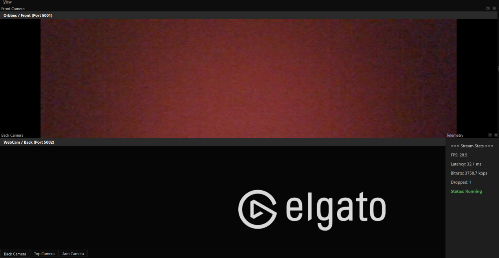

# Rover Multi-Camera Monitoring GUI

A **PySide6-based multi-camera monitoring interface** for rover operation. The application displays multiple live camera feeds in one desktop GUI and uses **GStreamer RTP/UDP streams** so each camera can run independently on its own port.

The interface also includes a dockable layout and live stream telemetry such as FPS, latency, bitrate, dropped frames, and stream status.

## Demo



The screenshot shows two simultaneous live sources:
- **Front Camera** — laptop webcam streamed to port `5001`
- **Back Camera** — Elgato capture source streamed to port `5002`

The system was also tested successfully with a third fake/test camera stream on port `5003`.

## Features

### Multi-Camera Monitoring
- Displays several camera feeds simultaneously
- Independent camera streams for front, back, top, and arm views
- Supports physical and simulated/test camera feeds
- Each stream uses its own UDP port
- Cameras and the GUI can be started in any order

### Dockable GUI
- Camera panels can be moved, floated, tabbed, hidden, and restored
- Separate views for different rover camera positions
- Centralized monitoring layout for rover operators
- View menu for camera panel management

### Camera Controls
The GUI is designed to support controls for:
- Exposure
- Gain
- White balance
- Resolution
- FPS
- Brightness
- Contrast
- Saturation
- Sharpness
- Zoom

### Stream Telemetry
The interface displays real-time information including:
- FPS
- Latency
- Bitrate
- Dropped frames
- Stream status

## Technologies

- Python
- PySide6 / Qt
- GStreamer
- RTP / UDP streaming
- Media Foundation (`mfvideosrc`) on Windows
- PyGObject (`gi`)
- Real-time video streaming
- Multi-camera GUI design

## System Architecture

```text
Laptop Webcam
 device-index=0
      |
      | GStreamer RTP/JPEG
      v
 UDP Port 5001
      |
      v
+-----------------------------+
| Rover Multi-Camera GUI      |
|                             |
| Front / Back / Top / Arm    |
| Camera Panels               |
|                             |
| Stream Telemetry            |
+-----------------------------+
      ^
      |
 UDP Port 5002
      ^
      | GStreamer RTP/JPEG
      |
Elgato / Secondary Camera
 device-index=1

Fake/Test Camera -> UDP Port 5003 -> GUI
```

Each source is independent, which means the streams do not need to be launched in a specific order.

## Tested Camera Setup

```text
Port 5001 -> Main laptop camera
Port 5002 -> Elgato capture source
Port 5003 -> Fake/test camera
```

All three streams were tested simultaneously.

## Windows Camera Streaming

The physical camera feeds were tested on Windows using GStreamer's **Media Foundation** source.

### Main Laptop Camera

```bash
python -c "import gi; gi.require_version('Gst', '1.0'); from gi.repository import Gst, GLib; Gst.init(None); p=Gst.parse_launch('mfvideosrc device-index=0 ! videoconvert ! jpegenc ! rtpjpegpay ! udpsink host=127.0.0.1 port=5001'); p.set_state(Gst.State.PLAYING); GLib.MainLoop().run()"
```

This captures `device-index=0` and sends the video to:

```text
127.0.0.1:5001
```

### Elgato / Secondary Camera

```bash
python -c "import gi; gi.require_version('Gst', '1.0'); from gi.repository import Gst, GLib; Gst.init(None); p=Gst.parse_launch('mfvideosrc device-index=1 ! videoconvert ! jpegenc ! rtpjpegpay ! udpsink host=127.0.0.1 port=5002'); p.set_state(Gst.State.PLAYING); GLib.MainLoop().run()"
```

This captures `device-index=1` and sends the stream to:

```text
127.0.0.1:5002
```

### Start the GUI

In another terminal:

```bash
python main.py
```

The camera sender processes and GUI can be started in any order.

## GStreamer Pipeline

```text
Camera
  |
  v
mfvideosrc
  |
  v
videoconvert
  |
  v
jpegenc
  |
  v
rtpjpegpay
  |
  v
udpsink
  |
  v
UDP Port
  |
  v
Rover Monitoring GUI
```

Pipeline components:
- `mfvideosrc` — captures a Windows camera through Media Foundation
- `videoconvert` — converts the video to a compatible format
- `jpegenc` — encodes frames as JPEG
- `rtpjpegpay` — packages JPEG frames into RTP packets
- `udpsink` — transmits the stream over UDP

## Persistent Camera Identification

A major goal of the project is to avoid depending only on changing camera indices such as `/dev/videoN`.

The camera management approach uses logical camera roles and Windows-friendly device names, for example:

```text
Orbbec / Front
WebCam / Back
IP Cam / Top
IR Cam / ARM
```

Example matching rules:

```text
Orbbec / Front -> FriendlyName contains "Orbbec"
WebCam / Back   -> FriendlyName contains "UVC HD Camera"
IP Cam / Top    -> FriendlyName contains "USB Camera"
IR Cam / ARM    -> FriendlyName contains "IR"
```

This allows the GUI to map the intended rover camera role to the correct physical device even when camera enumeration changes after reconnects or reboots.

## Project Structure

```text
Rover-Multi-Camera-Monitoring-GUI/
└── Project Files for Rover Multi-Camera Monitoring GUI/
    ├── Python GUI source files
    ├── camera management logic
    ├── GStreamer stream handling
    ├── camera controls
    ├── telemetry display
    └── supporting project files
```

## Installation

### Requirements

- Python 3
- PySide6
- GStreamer 1.x
- PyGObject / GStreamer Python bindings
- Windows camera support for `mfvideosrc`

### Clone the Repository

```bash
git clone https://github.com/kre07/Rover-Multi-Camera-Monitoring-GUI.git
cd Rover-Multi-Camera-Monitoring-GUI
```

Install the project's Python dependencies and ensure GStreamer is installed and available on your system path.

## Use Case

This GUI was developed for a rover camera system where an operator may need to monitor several viewpoints at once, including:

- Front navigation camera
- Rear camera
- Top camera
- Robotic-arm camera

Separating the camera sources from the GUI through independent UDP streams keeps the display system modular and allows sources to connect or disconnect independently.

## What This Project Demonstrates

- Real-time multi-camera video streaming
- Desktop GUI development with PySide6
- GStreamer video pipelines
- RTP and UDP networking
- Windows Media Foundation camera capture
- Persistent camera-role mapping
- Concurrent independent video sources
- Dockable operator interfaces
- Live stream telemetry
- Robotics monitoring software

## Author

**Kritagya Sharma**

GitHub: [@kre07](https://github.com/kre07)
