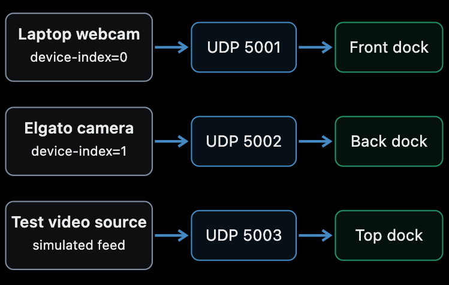

# Rover Multi-Camera Monitoring GUI

A **PySide6-based multi-camera monitoring interface** for rover operation. The application displays multiple live camera feeds in one desktop GUI and uses **GStreamer RTP/UDP streams** so each camera can run independently on its own port.

The interface also includes a dockable layout and telemetry displays for FPS, latency, bitrate, dropped frames, and stream status. Some displayed values are currently simulated for GUI testing.

## Demo


The screenshot shows two simultaneous live sources:
- **Front Camera** — laptop webcam streamed to port `5001`
- **Back Camera** — Elgato capture source streamed to port `5002`

The system was also tested successfully with a third fake/test camera stream on port `5003`.

## Features

### Multi-Camera Monitoring
- Displays several camera feeds simultaneously
- Independent camera streams for front, back, top, and arm views
- Supports physical and simulated/test camera feeds
- Each stream uses its own UDP port
- Cameras and the GUI can be started in any order

### Dockable GUI
- Camera panels can be moved, floated, tabbed, hidden, and restored
- Separate views for different rover camera positions
- Centralized monitoring layout for rover operators
- View menu for camera panel management

### Camera Controls
The GUI is designed to support controls for:
- Exposure
- Gain
- White balance
- Resolution
- FPS
- Brightness
- Contrast
- Saturation
- Sharpness
- Zoom

### Stream Telemetry
The interface includes telemetry displays for:
- FPS
- Latency
- Bitrate
- Dropped frames
- Stream status

**Note:** the current `main.py` uses simulated telemetry values for GUI testing; these should not be interpreted as verified measurements from the live video pipeline.

## Technologies

- Python
- PySide6 / Qt
- GStreamer
- RTP / UDP streaming
- Media Foundation (`mfvideosrc`) on Windows
- PyGObject (`gi`)
- Real-time video streaming
- Multi-camera GUI design

## System Architecture: Camera-to-UDP-Port Routing



**How the mapping works:** each independently launched **GStreamer sender** selects a video source and publishes its RTP/JPEG stream to a specific **UDP port**. The PySide6 GUI subscribes to that port and displays the incoming video in the corresponding dock. This keeps the GUI independent of the camera capture index.

| Video source in tested setup | Sender configuration | UDP port | GUI destination |
| --- | --- | --- | --- |
| Laptop webcam | `mfvideosrc device-index=0` | `5001` | Front dock |
| Elgato camera | `mfvideosrc device-index=1` | `5002` | Back dock |
| Simulated/test video | GStreamer test source | `5003` | Top dock |
| Additional input (configured in GUI) | Sender must be configured separately | `5004` | Arm dock |

In `main.py`, the GUI binds these destinations by calling `front_dock.start(port=5001)`, `back_dock.start(port=5002)`, `top_dock.start(port=5003)`, and `arm_dock.start(port=5004)`. In `video_widget.py`, each panel uses `udpsrc port=...` to receive and decode its video.

**Why this design helps:** the GUI does not have to open a camera by its changing `device-index`; it listens on stable, predefined ports instead. The sender still chooses the physical camera using `device-index` (or another source selector), so if Windows renumbers devices, the sender's device selection may need updating. A fixed port identifies the *destination panel*, not automatically the physical camera itself.

The three pictured routes describe the tested setup; the GUI also supports a fourth listening port for the arm camera.

## Tested Camera Setup

```text
Port 5001 -> Main laptop camera
Port 5002 -> Elgato capture source
Port 5003 -> Fake/test camera
```

All three streams were tested simultaneously.

## Windows Camera Streaming

The physical camera feeds were tested on Windows using GStreamer's **Media Foundation** source.

### Main Laptop Camera

```bash
python -c "import gi; gi.require_version('Gst', '1.0'); from gi.repository import Gst, GLib; Gst.init(None); p=Gst.parse_launch('mfvideosrc device-index=0 ! videoconvert ! jpegenc ! rtpjpegpay ! udpsink host=127.0.0.1 port=5001'); p.set_state(Gst.State.PLAYING); GLib.MainLoop().run()"
```

This captures `device-index=0` and sends the video to:

```text
127.0.0.1:5001
```

### Elgato / Secondary Camera

```bash
python -c "import gi; gi.require_version('Gst', '1.0'); from gi.repository import Gst, GLib; Gst.init(None); p=Gst.parse_launch('mfvideosrc device-index=1 ! videoconvert ! jpegenc ! rtpjpegpay ! udpsink host=127.0.0.1 port=5002'); p.set_state(Gst.State.PLAYING); GLib.MainLoop().run()"
```

This captures `device-index=1` and sends the stream to:

```text
127.0.0.1:5002
```

### Start the GUI

In another terminal:

```bash
python main.py
```

The camera sender processes and GUI can be started in any order.

## GStreamer Pipeline

```text
Camera
  |
  v
mfvideosrc
  |
  v
videoconvert
  |
  v
jpegenc
  |
  v
rtpjpegpay
  |
  v
udpsink
  |
  v
UDP Port
  |
  v
Rover Monitoring GUI
```

Pipeline components:
- `mfvideosrc` — captures a Windows camera through Media Foundation
- `videoconvert` — converts the video to a compatible format
- `jpegenc` — encodes frames as JPEG
- `rtpjpegpay` — packages JPEG frames into RTP packets
- `udpsink` — transmits the stream over UDP

## Camera Identification and Device Discovery

The primary **working stream-to-panel mapping** uses the UDP ports shown above. The GUI itself does not depend on Windows camera enumeration order, even though the sender commands in the tested setup still select cameras by index.

The repository also contains a **separate camera-discovery utility** in `camera_manager.py`. It calls PowerShell's `Get-PnpDevice -Class Camera` to enumerate friendly device names and matches them to logical camera roles. The current source includes these example mappings:

```text
Orbbec / Front -> "HD User Facing" (laptop webcam in this test)
WebCam / Back  -> "Elgato Facecam"
IP Cam / Top   -> "USB Camera"
IR Cam / ARM   -> "IR"
```

`live_camera_test.py` separately demonstrates looking up a Windows-friendly device name and attempting to open that device with GStreamer, with a local test-pattern fallback if starting the camera fails.

**Current implementation boundary:** `main.py` does not call `CameraManager` to select and launch the UDP senders automatically. Device-name discovery and UDP-port routing are implemented as separate pieces. The project therefore demonstrates port-based GUI routing, **not yet fully automatic physical-camera-to-port binding**.

## Project Structure

```text
Rover-Multi-Camera-Monitoring-GUI/
└── Project Files for Rover Multi-Camera Monitoring GUI/
    ├── Python GUI source files
    ├── camera management logic
    ├── GStreamer stream handling
    ├── camera controls
    ├── telemetry display
    └── supporting project files
```

## Installation

### Requirements

- Python 3
- PySide6
- GStreamer 1.x
- PyGObject / GStreamer Python bindings
- Windows camera support for `mfvideosrc`

### Clone the Repository

```bash
git clone https://github.com/kre07/Rover-Multi-Camera-Monitoring-GUI.git
cd Rover-Multi-Camera-Monitoring-GUI
```

Install the project's Python dependencies and ensure GStreamer is installed and available on your system path.

## Use Case

This GUI was developed for a rover camera system where an operator may need to monitor several viewpoints at once, including:

- Front navigation camera
- Rear camera
- Top camera
- Robotic-arm camera

Separating the camera sources from the GUI through independent UDP streams keeps the display system modular and allows sources to connect or disconnect independently.

## What This Project Demonstrates

- Real-time multi-camera video streaming
- Desktop GUI development with PySide6
- GStreamer video pipelines
- RTP and UDP networking
- Windows Media Foundation camera capture
- UDP-port-based camera-panel routing and separate device-name discovery
- Concurrent independent video sources
- Dockable operator interfaces
- Telemetry display scaffolding
- Robotics monitoring software

## Author

**Kritagya Sharma**

GitHub: [@kre07](https://github.com/kre07)
